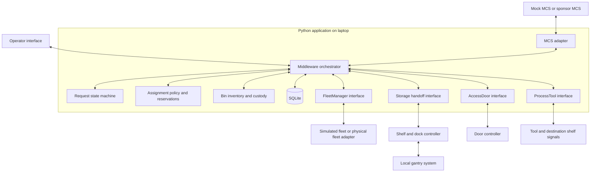

# Material Delivery Middleware Architecture

Status: proposed coding baseline for team review. This document specifies target behavior; the existing repository is a skeleton and does not implement every component below.

## Purpose and scope

The Python middleware coordinates delivery of one identified bin from storage to a process tool or its delivery shelf. It receives requests, checks readiness, coordinates transport and transfer, tracks bin custody and contents, and reports results to the MCS. Device controllers execute physical motion and enforce local interlocks.

The prototype uses simulated external systems first, followed by physical integration. Simulation supports development; the EE report's demonstration includes physical signals and transfer authorization and confirmation.

## References and interpretation

| Reference | Design contribution |
| --- | --- |
| `docs/Capstone UML.asta` and its exported PDF | Domain classes, external interfaces, request states, sequence and failure paths |
| Mechanical CDR, October 20, 2026, slides 5 and 12–14 | Bin tracking, storage and destination transfers, tool requests, human interaction |
| EE Progress Report 1, October 9, 2026, customer discovery and project scope | Material-needed signals, destination readiness, identification, door access, confirmation and timing tests |
| Anith's Control Logic Diagrams, November 6, 2026 | Dock state sequence, QR identification, ESP32-S3 motion controller, independent gantry concept |

The Mechanical, EE and Anith documents were supplied as design references and may not be present in this repository. Do not interpret this baseline as sponsor approval or demonstrated ISO/SEMI compliance. Numerical timing and electrical interface requirements remain open.

## Components



Interfaces are logical boundaries. A single EE controller may expose several interfaces. Begin with one middleware process, one database and an internal event queue; separate device simulators into processes when integrating the transport.

| Component | Owns |
| --- | --- |
| Middleware | Request validation, workflow coordination, status reporting |
| Assignment policy | Select an eligible AMR or validate an MCS-provided assignment |
| Reservations | Exclusive ownership of AMRs, bins, handoff points and destinations |
| Inventory | Bin identity, contents, last confirmed location/custodian and observation freshness |
| FleetManager | High-level transport tasks and robot progress; vendor internals stay outside middleware |
| AMR controller | Navigation execution, PID, obstacle response, motor control and local stopping |
| Storage/dock controller | Presence, QR observation, alignment, transfer sequence and transfer result |
| Gantry controller | Local retrieval and placement motion |
| AccessDoor | Access request/result, door state and passage events; physical interlocks remain local |
| ProcessTool | Material-needed, readiness, authorization and receipt signals |
| OperatorInterface | Fill prompts, recorded human confirmations and recovery decisions |

## Compatibility with the UML

Preserve `DeliveryRequest`, `AMR`, `Bin`, `Point`, `HumanReport`, `ProcessTool`, `ToolHandshake`, existing enumerations and external interfaces. Preserve the middleware entry points:

```python
receive_delivery_request(request)
receive_report(report)
receive_amr_status(amr, status)
receive_handshake(handshake)
```

Add typed internal events with request, command, bin, device and location IDs. Existing signatures can delegate to event handlers. Compare stable IDs rather than Python object identity.

Retain `StorageGantry.place_bin_at_handoff(bin)` as a compatibility facade. Completion must be reported asynchronously. A commanded adapter requests preparation; an independent adapter waits for locally prepared matching stock without sending a movement command. The latter does not solve bin selection: the local system or operator must know which bin to prepare. Record the chosen mechanism before hardware integration.

## Request lifecycle

Keep the UML's seven request states: `PENDING`, `ASSIGNED`, `AWAITING_ACCESS`, `IN_TRANSIT`, `DELIVERED`, `CONFIRMED`, `FAILED`.

| From | Event and guard | To |
| --- | --- | --- |
| Start | Valid unique request accepted | PENDING |
| PENDING | Correct bin prepared and identified; destination freshly ready; AMR available; resources reserved; assignment accepted | ASSIGNED |
| ASSIGNED | Matching bin collected onto AMR and transfer area clear | IN_TRANSIT |
| ASSIGNED or IN_TRANSIT | Relevant door waiting point reached | AWAITING_ACCESS |
| AWAITING_ACCESS | Access granted; bin not collected | ASSIGNED |
| AWAITING_ACCESS | Access granted; bin collected | IN_TRANSIT |
| AWAITING_ACCESS | Denied; retries remain | AWAITING_ACCESS |
| AWAITING_ACCESS | Denied; retries exhausted | FAILED |
| IN_TRANSIT | Blocked and fleet reports an available reroute | IN_TRANSIT |
| IN_TRANSIT | Matching destination transfer complete | DELIVERED |
| DELIVERED | Matching recipient/tool confirms receipt | CONFIRMED |
| ASSIGNED | Pickup timeout or AMR error | FAILED |
| IN_TRANSIT | AMR error | FAILED |
| DELIVERED | Confirmation timeout | FAILED |

`DELIVERED` requires bin handoff evidence, not simply robot arrival. This refines the UML arrival event using the Mechanical and EE requirements and must be reflected in a later UML update. Events for other unmodeled faults hold progression and create a recovery incident; do not invent successful transitions.

Record detailed `execution_phase` separately: `WAITING_FOR_PREPARATION`, `TO_PICKUP`, `LOADING`, `TO_DESTINATION`, `UNLOADING`. Preserve whether the bin was collected while waiting for access. Bin contents prepared and bin physically collected are distinct facts.

The dock controller independently follows `IDLE → BIN_SEATED → QR_VERIFIED → READY_FOR_AMR → AMR_DOCKED → TRANSFERRING → CONFIRMED → IDLE`, with a local fault path. Local transfer confirmation does not complete a delivery request.

## Normal delivery

1. A tool emits a material-needed signal. The Mock MCS converts it to one request; a sponsor MCS can later own that conversion. Deduplicate the original need.
2. Middleware validates the request, records it and requests preparation through the configured storage integration. An operator may confirm contents preparation.
3. Storage reports the correct bin identified and ready. Middleware obtains fresh destination readiness.
4. The scheduler reserves resources and sends the assignment through FleetManager. Prioritize eligible requests by priority, then accepted time. Define larger numeric priority as more urgent in the prototype.
5. The AMR reaches pickup; the local controller verifies alignment and authorizes transfer.
6. Matching collection evidence and transfer clearance advance the request to IN_TRANSIT.
7. Door access is coordinated at the waiting point when required. Local controllers enforce actual passage permission.
8. Before unloading, recheck destination identity, readiness and authorization. The destination controller confirms the bin transfer.
9. Mark DELIVERED and release the AMR only after confirmed physical clearance. Tool/recipient receipt advances to CONFIRMED.
10. Report transitions to MCS and retain event and command history.

## Tracking and persistence

Use SQLite repositories for deliveries, bins, locations, devices, reservations, events, commands and processed message IDs. Store timestamps in UTC. Bin custody is a shelf slot, dock, AMR, destination or unknown; correlate a carried bin with AMR position updates. Expose observation time and stale/unknown state rather than presenting stale data as current.

Reserve resources atomically. A duplicate request with identical content returns the existing result; a conflicting request with the same ID is rejected. Store the state change, processed event ID and outgoing command in one transaction. Publish stored pending commands after commit.

Network callbacks validate and enqueue events. One worker applies workflow changes initially. Device acknowledgements indicate acceptance, not physical completion. See [interface contracts](INTERFACES.md).

## Failure and recovery

Use separate configurable acknowledgement, action and receipt deadlines. Simulation values are test parameters, not physical timing requirements. The device checks command expiry and local preconditions before acting.

Retry a command using the same command ID only when the receiver supports deduplication. For an uncertain physical action, query status and reconcile before retrying. Persistent receiving-side command records or equivalent reconciliation are necessary across controller restarts.

On disconnect or contradictory evidence, hold dependent progression and create an incident. A FAILED request can still own a bin or occupy a dock: retain affected reservations until custody and clearance are verified. On application restart, reconcile outstanding commands, device state, bin custody and reservations before resuming movement.

## Repository layout

```text
src/capstone/
  models/                 # UML models plus typed commands and events
  middleware/
    middleware.py         # Orchestration and existing entry points
    request_state.py      # Transition table and guards
    assignment_policy.py
    reservations.py
    inventory.py
    command_tracker.py
  interfaces/             # Existing UML boundaries and tool signal contract
  adapters/               # MCS, fleet, storage, door, tool translations
  messaging/              # Validation, routing, MQTT transport
  persistence/            # SQLite repositories and schema migrations
  simulators/             # Mock MCS, fleet, dock, door, tool
  config.py
  main.py
  cli.py
```

Python remains the middleware language. Keep domain dataclasses; validate external messages at adapter boundaries. MQTT with Paho and a Mosquitto broker is the proposed prototype transport, subject to device support. Keep MQTT outside domain logic. SQLite and pytest support the initial implementation. A CLI is sufficient initially; a web dashboard can follow the working workflow.

## Decisions still needed

| Decision | Working implementation choice | Hardware dependency |
| --- | --- | --- |
| Request origin | Tool need passes through Mock MCS to one request | Sponsor entry protocol |
| AMR selection | Replaceable middleware policy | Whether MCS supplies assignment |
| Gantry selection/control | Simulated commanded adapter; independent adapter supported | Local bin-selection mechanism and controller protocol |
| Door ownership | Middleware calls AccessDoor; local controller enforces interlocks | Authorization method and signal timing |
| Alignment and transfer evidence | Explicit simulator events | Sensors and responsible controller |
| Readiness freshness and timeouts | Configurable simulation settings | EE/ME measurements and sponsor values |
| Empty-bin return | Separate request with EMPTIED readiness | Return destination and receipt authority |

These choices allow core coding now. Do not claim the return workflow or a physical interface is complete until its evidence and confirmation authority are defined.
